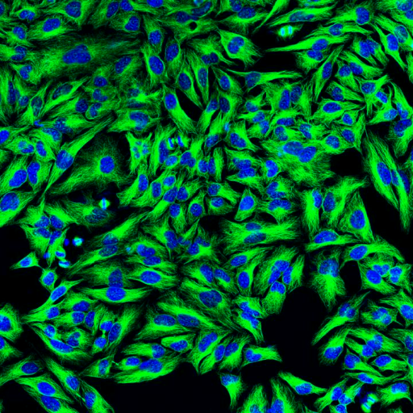
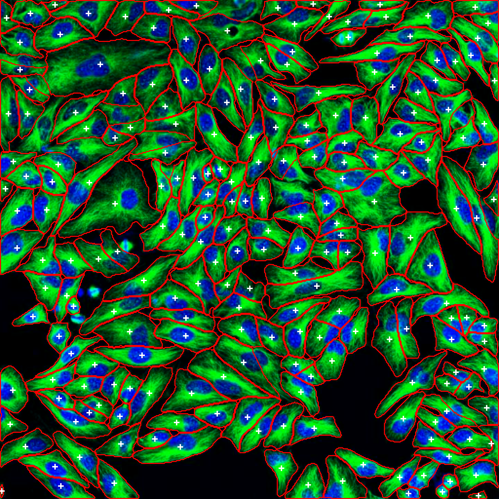

# Cellpose MCP Server

[](https://github.com/surajinacademia/cellpose_mcp/actions/workflows/ci.yml)
[](https://pypi.org/project/cellpose-mcp/)
[](https://github.com/surajinacademia/cellpose_mcp/blob/main/LICENSE)

An MCP server that lets an AI assistant segment cells and nuclei with [Cellpose](https://github.com/MouseLand/cellpose): in 2D or 3D, one image or a folder, with optional denoising, deblurring, or upsampling first, and with your own trained models.

| Raw image | Segmented by the assistant |
| --- | --- |
|  |  |

## Tools

| Tool | What it does |
| --- | --- |
| `load_image_info` | Reports an image's shape, data type, and channels. |
| `list_available_models` | Lists the Cellpose models you can use. |
| `estimate_cell_diameter` | Estimates the typical cell diameter, in pixels. |
| `segment_cells_2d` | Segments cells in one 2D image. |
| `segment_cells_3d` | Segments cells in a 3D volume. |
| `segment_cells_batch` | Segments every image in a folder. |
| `denoise_image`, `deblur_image`, `upsample_image` | Restore an image before segmenting it. |
| `restore_and_segment` | Restores and segments in one step. |
| `save_masks` | Saves masks (TIFF, PNG, or NumPy) with an outline PNG and an overlay PNG. |
| `train_segmentation_model` | Trains a model on your own images and masks. |

For images with more than one channel, say which axis holds the channels (`channel_axis`) and which channels are the cell and the nuclear signal (`channels`, counted from 1). The server does not guess.

## Install

Needs Python 3.10, 3.11, or 3.12. It installs Cellpose 3.1.1.2; Cellpose 4 lacks the restoration tools.

```bash
pip install cellpose-mcp
```

## Connect

**Claude Code**

```bash
claude mcp add cellpose -e KMP_DUPLICATE_LIB_OK=TRUE -e OMP_NUM_THREADS=1 -- cellpose-mcp
```

**Codex**

```bash
codex mcp add cellpose --env KMP_DUPLICATE_LIB_OK=TRUE --env OMP_NUM_THREADS=1 -- cellpose-mcp
```

**Claude Desktop, Cursor, Gemini CLI, and Antigravity** use the same entry:

```json
{
  "mcpServers": {
    "cellpose": {
      "command": "cellpose-mcp",
      "env": { "KMP_DUPLICATE_LIB_OK": "TRUE", "OMP_NUM_THREADS": "1" }
    }
  }
}
```

| Client | Where the entry goes |
| --- | --- |
| Claude Desktop | `~/Library/Application Support/Claude/claude_desktop_config.json` (macOS) or `%APPDATA%\Claude\claude_desktop_config.json` (Windows), then restart the app |
| Cursor | `~/.cursor/mcp.json`, or `.cursor/mcp.json` in a project |
| Gemini CLI | `~/.gemini/settings.json`, or `.gemini/settings.json` in a project |
| Antigravity | Agent panel `…` menu → MCP Servers → Manage MCP Servers → View raw config |

`cellpose-mcp-install cursor` (or `claude-desktop`, `antigravity`, `claude-code`, `vscode`) writes the entry for you. If a client cannot find `cellpose-mcp`, use the full path that `which cellpose-mcp` prints.

## Use

> List the available Cellpose models, then segment the cells in `/data/sample.tif` with cyto2 and save the masks next to it.

> Denoise `/data/noisy.tif`, segment it, and tell me how many cells you found.

## Evaluation

A Codex agent ran 12 segmentation tasks through this server on six annotated nuclei images from the public BBBC039 dataset, three times each, alongside a direct Cellpose script that does not use the server. The agent completed all 36 workflows, its masks were pixel-identical to the direct script's in all 30 paired outputs, and it asked for clarification or refused correctly whenever a task required it. Against the annotations, Cellpose reached an object F1 of 0.93–0.97 on five images and 0.44 on one sparse image, in both arms. The [evaluation](https://github.com/surajinacademia/cellpose_mcp/tree/main/evaluation/pilot-2026-10) has the design, the per-run and per-image scores, and the limits.

## Development

```bash
git clone https://github.com/surajinacademia/cellpose_mcp && cd cellpose_mcp
pip install -e '.[test,dev]'
pytest -m 'not slow'
```

The [changelog](https://github.com/surajinacademia/cellpose_mcp/blob/main/CHANGELOG.md) lists each release.

## Credits and license

Built on [Cellpose](https://github.com/MouseLand/cellpose) by Carsen Stringer, Marius Pachitariu, and colleagues; please cite Cellpose when you publish results. [napari-mcp](https://github.com/royerlab/napari-mcp) by the Royer lab inspired the design, and the server uses [FastMCP](https://github.com/jlowin/fastmcp). Written by [Suraj Sahu](https://physics.ucmerced.edu/content/suraj-sahu), University of California, Merced.

The code is BSD-3-Clause; see [LICENSE](https://github.com/surajinacademia/cellpose_mcp/blob/main/LICENSE). The example images are Cellpose's and are for non-commercial use; see [THIRD_PARTY_NOTICES.md](https://github.com/surajinacademia/cellpose_mcp/blob/main/THIRD_PARTY_NOTICES.md).
