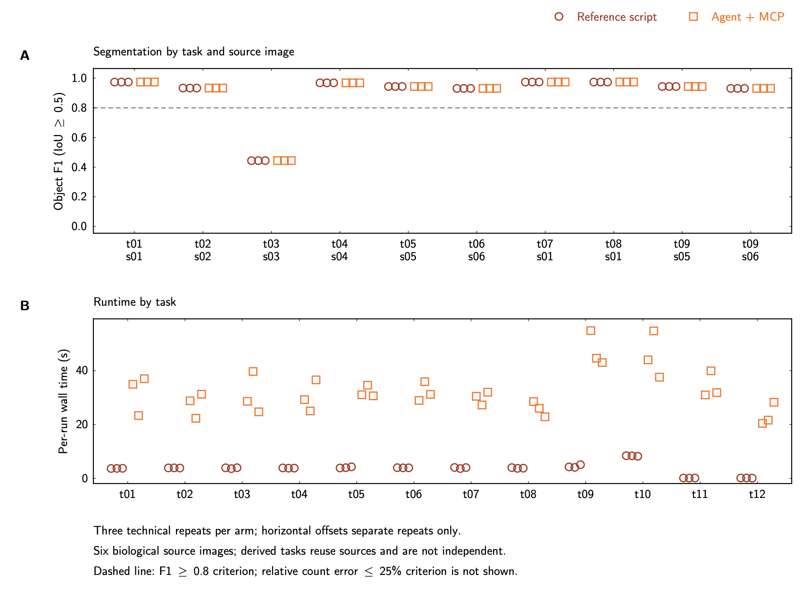

# Cellpose MCP evaluation: agent versus direct script

Can an AI agent run real segmentation tasks correctly through this server? We gave a Codex agent 12 tasks on six nuclei images and ran the same tasks with a direct Cellpose script that does not use the server. Each task ran three times in each arm, 72 runs in all, and every output was scored against expert annotations.

## Result

The agent completed all 36 of its workflows and produced masks pixel-identical to the direct script in all 30 paired outputs. It asked for clarification when an image's axes were ambiguous and refused an unsupported model instead of substituting one, in every repeat.

| | Direct script | Agent through MCP |
| --- | --- | --- |
| Workflows completed | 36 / 36 | 36 / 36 |
| Segmentations meeting the annotation criteria | 24 / 27 | 24 / 27 |
| Correct clarification or refusal | 6 / 6 | 6 / 6 |
| Median time per run | 3.9 s | 31.0 s |
| Human interventions | 0 | 0 |

Segmentation quality is Cellpose's, shared by both arms. Matching predicted to annotated nuclei at IoU ≥ 0.5:

| Image | Annotated | Predicted | Object F1 |
| --- | ---: | ---: | ---: |
| s01 | 156 | 150 | 0.974 |
| s02 | 119 | 106 | 0.933 |
| s03 | 7 | 2 | 0.444 |
| s04 | 82 | 77 | 0.969 |
| s05 | 93 | 85 | 0.944 |
| s06 | 62 | 54 | 0.931 |

Image s03 failed in both arms, and so did the diameter estimate for it (15.0 px against 28.7 px from the annotations). These are limits of the Cellpose model on that image, not of the server.

## Design

- **Data:** six Hoechst-stained U2OS nuclei images from the public [BBBC039](https://bbbc.broadinstitute.org/BBBC039) dataset (CC0), with its annotations.
- **Tasks:** segment single images, six-channel images in two axis layouts, and a batch; estimate a diameter; ask for clarification on an ambiguous array; refuse an unsupported model. See [tasks.json](tasks.json).
- **Agent:** Codex CLI in a fresh process per run, with shell, web, memory, and skills disabled, at most 10 tool calls, and no human follow-up.
- **Pass criteria:** for segmentation, object F1 ≥ 0.80 and count error ≤ 25 % on every image. The [protocol](PROTOCOL.md) was frozen before any run was scored.

## Limits

The six images come from one assay, and the three repeats measure technical, not biological, variation. Some BBBC039 images may overlap Cellpose's training data. The direct script was written for these tasks in advance, so the time comparison leaves out the effort of writing it.

## Files

- [summary.json](summary.json): totals per arm.
- [run_scores.csv](run_scores.csv): one row per run, with pass flags, time, tool calls, and tokens.
- [per_image_scores.csv](per_image_scores.csv): one row per scored image.
- [PROTOCOL.md](PROTOCOL.md) and [tasks.json](tasks.json): the frozen design and the exact task prompts.

The raw transcripts, masks, and model weights (about 270 MB) are kept out of this repository.
